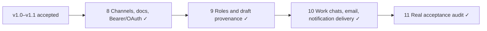

# Roadmap: Universal UserIO

## Milestones

- ✅ **v1.0 MAX personal account** — Phases 1–3, accepted 2026-10-11.
- ✅ **v1.1 Human web send, MAX editing and phone conversations** — Phases 4–7, accepted 2026-10-12.
- 🚧 **v1.2 Reliable everyday communication** — Phases 8–11, active.

Accepted v1.0/v1.1 history

Phase 1: existing MAX personal authorization and server session.
Phase 2: exact provider history/live projection and dedup.
Phase 3: approved provider reply/reconnect/native acceptance.
Phase 4: direct human web Send/Enter, durable receipts.
Phase 5: same-ID native MAX editing.
Phase 6: Darья URL→URL→plain repeated editing, stickers, compact UI.
Phase 7: phone calls grouped by person, numbers, retained lifecycle and paging.

Original records preserved in [prior roadmap](milestones/v1.1-ROADMAP-before-reconciliation.md),
[prior requirements](milestones/v1.1-REQUIREMENTS-before-reconciliation.md) and
[full accepted history](milestones/v1.1-STATE-before-reconciliation.md).
Recovery uses existing acceptance receipts, not repeated provider actions.

## v1.2 Reliable everyday communication

## Phases

- [x] **Phase 8: Everyday channels and AI connections** - One clear phone/SMS account, continuous sync, onboarding/docs, read preferences and usable Bearer/OAuth MCP connections.
- [x] **Phase 9: Secretary roles and draft provenance** - Reply suggestions distinguish the owner, retain the exact incoming source/time and show when context changed. (completed 2026-10-12)
- [x] **Phase 10: Timely work-chat and email notifications** - Restore maintained dispatcher credentials, remove proven queue delay, enable verified work chats and explain emails substantively. (completed 2026-10-12)
- [x] **Phase 11: Final real-surface acceptance** - Audit all user requests against published source, installed runtime and actual user-surface evidence. (completed 2026-10-12)

## Phase Details

### Phase 8: Everyday channels and AI connections
**Goal**: One clear phone/SMS account, continuous sync, onboarding/docs, read preferences and usable Bearer/OAuth MCP connections.
**Depends on**: v1.1 accepted baseline (archived)
**Requirements**: [SMS-01, PHONE-01, GUIDE-01, GROUP-01, WEB-01, DOC-01, MCP-01, MCP-02]
**Success Criteria** (what must be TRUE):
  1. New native SMS arrive automatically and old test accounts are absent.
  2. Website phone guide, account enrollment, authors, docs and cabinet navigation work normally.
  3. Users create and revoke multiple personal tokens; installed ChatGPT OAuth plugin reads their accounts.
**Plans**: 1 plan

Plans:
- [x] 08-01: Everyday channels and AI connections

### Phase 9: Secretary roles and draft provenance
**Goal**: Reply suggestions distinguish the owner, retain the exact incoming source/time and show when context changed.
**Depends on**: Phase 8
**Requirements**: [SEC-01, SEC-02, SEC-03]
**Success Criteria** (what must be TRUE):
  1. Actual native Fast Agent request distinguishes owner and interlocutor and uses the latest incoming question.
  2. Every new AI draft shows creation time and a clickable original message.
  3. New replies or edits mark the saved draft stale; legacy drafts have an honest unknown-source label.
**Plans**: 1 plan

Plans:
- [x] 09-01: Secretary roles and draft provenance

### Phase 10: Timely work-chat and email notifications
**Goal**: Restore maintained dispatcher credentials, remove proven queue delay, enable verified work chats and explain emails substantively.
**Depends on**: Phase 9
**Requirements**: [NOTIFY-01, WORK-01, MAIL-01]
**Success Criteria** (what must be TRUE):
  1. Maintained dispatcher authenticates and ordinary notifications are not blocked by a long deep-analysis job.
  2. Verified work-chat rules apply to future events without replaying accepted historical work.
  3. Email notification explains the sender, main facts, requested action and deadline rather than a tiny preview.
**Plans**: 1 plan

Plans:
- [x] 10-01: Timely work-chat and email notifications

### Phase 11: Final real-surface acceptance
**Goal**: Audit all user requests against published source, installed runtime and actual user-surface evidence.
**Depends on**: Phase 10
**Requirements**: [ACCEPT-01]
**Success Criteria** (what must be TRUE):
  1. All requirements have a real consumer proof or an explicit human-accepted exception.
  2. GSD native progress agrees with phases/plans and retained milestones.
  3. Owned canaries and resources are cleaned up; unrelated WIP and accepted sends remain intact.
**Plans**: 1 plan

Plans:
- [x] 11-01: Final real-surface acceptance

## Progress

| Phase | Plans Complete | Status | Completed |
|---|---|---|---|
| 8. Everyday channels and AI connections | 1/1 | Complete | 2026-10-12 |
| 9. Secretary roles and draft provenance | 1/1 | Complete   | 2026-10-12 |
| 10. Timely work-chat and email notifications | 1/1 | Complete   | 2026-10-12 |
| 11. Final real-surface acceptance | 1/1 | Complete   | 2026-10-12 |

## Delivery graph

Percentages refer to completed plans, never to inferred runtime health.
Historical phone viewport-anchor stability was not proved; history counts,
chronology and start/end preservation were proved. Four unknown September
numbers remain archived by the user's explicit decision.
